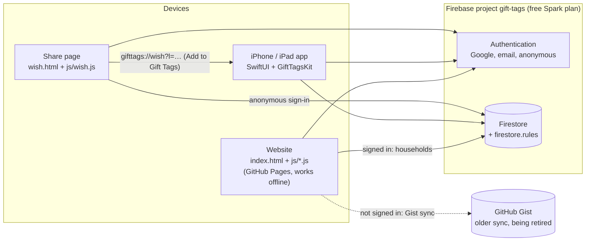
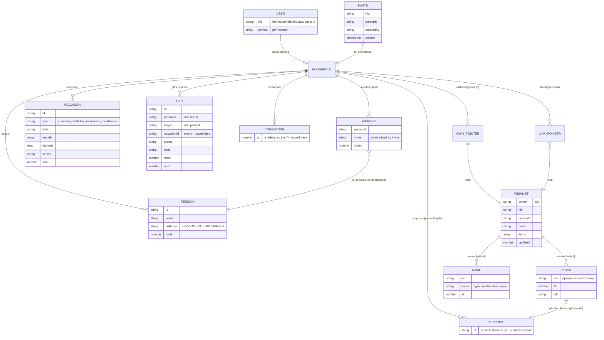
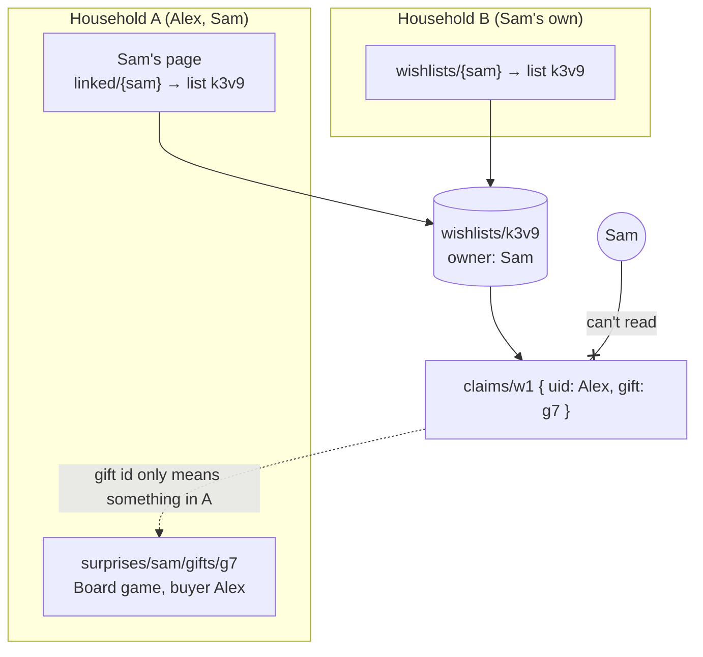
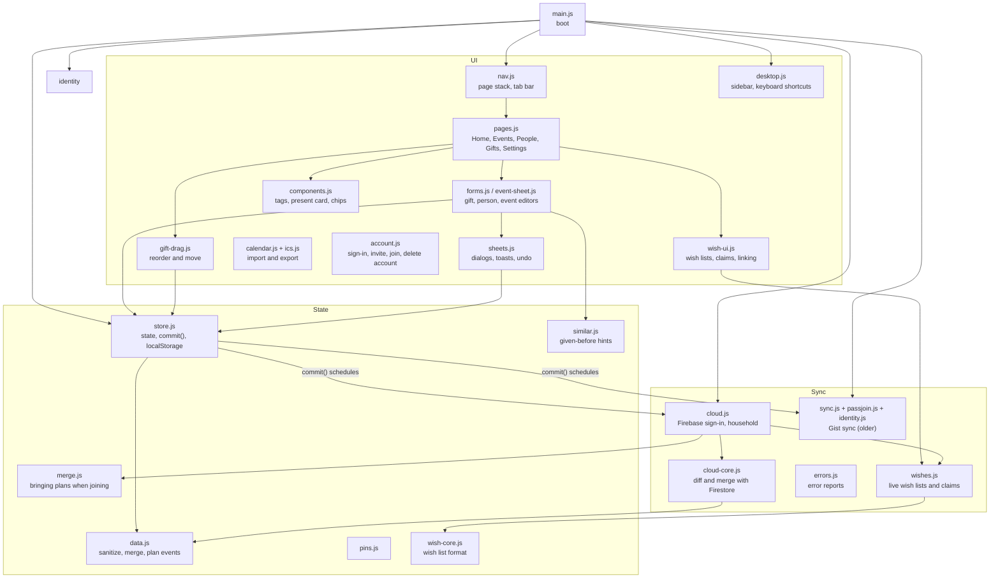
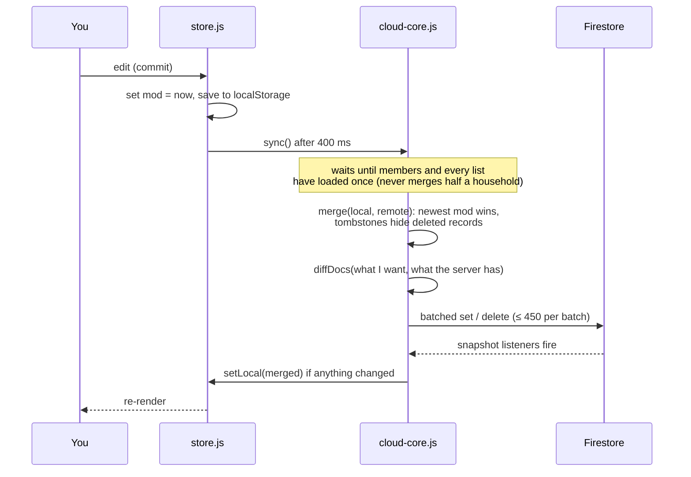
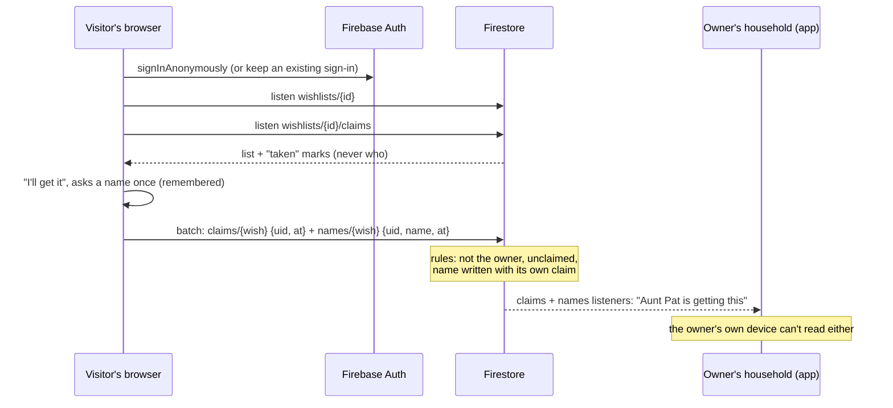
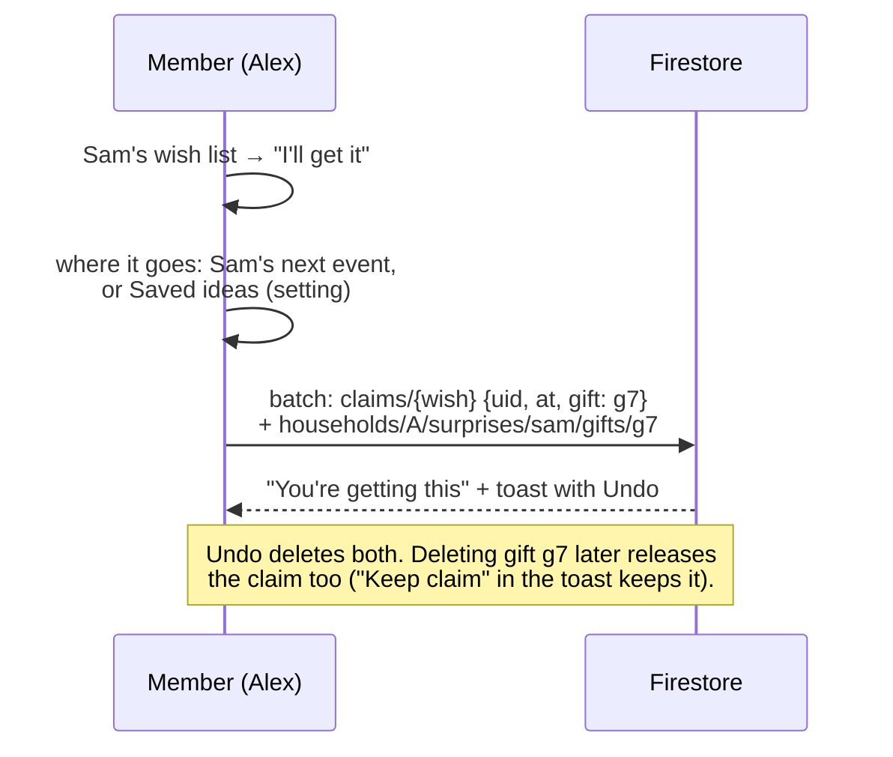
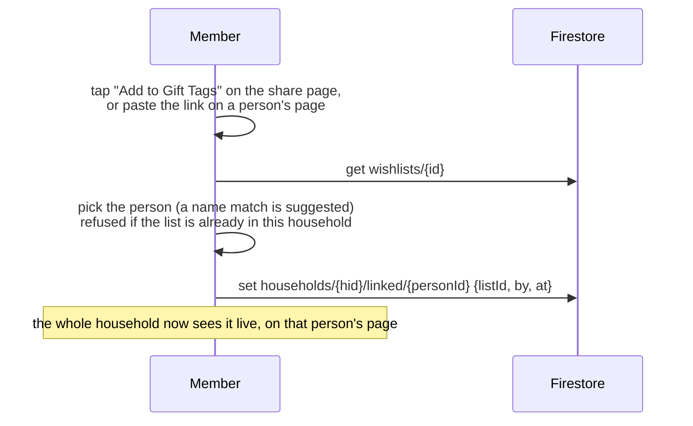
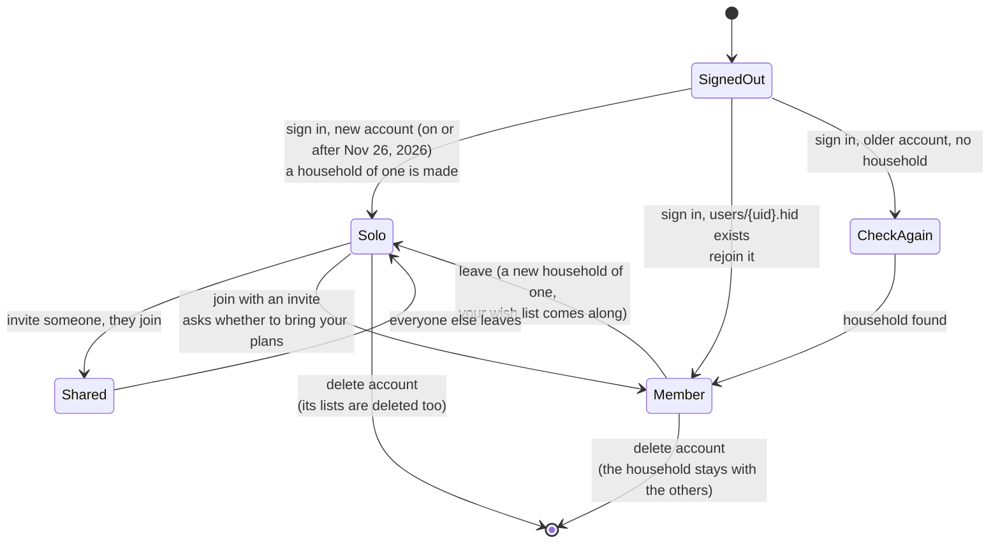
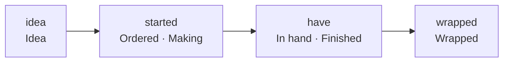

# Gift Tags architecture

How the pieces fit together: the website (this repo), the iPhone and iPad app (`~/gift-tags-apple`, see its
`docs/architecture.md`), and the Firebase project they share. The diagrams are Mermaid, so they render on
GitHub and in any Markdown viewer that supports it.

Updated November 28, 2026, after app build 0.3.

## 1. System overview

- **Firestore is the only server.** There's no backend code: every rule about who may read or write what is
  in `firestore.rules`, tested by `tests/rules/*.test.js` on the emulator.
- **Both apps are equal clients** of the same documents, so the document format below is a contract.
  The Swift side tests it in GiftTagsKit; the website's side is `js/cloud-core.js`.
- **The share page** is the only part that works without an account: a visitor signs in anonymously.

## 2. Data model

Paths are `households/{hid}/…` unless they start at the top: `users`, `invites`, `wishlists`, `errors`.

**Field rules both apps follow:** prices and budgets are a number, or `""` when empty. `mod` is milliseconds and
every edit sets it. A delete removes the document and writes a tombstone; when copies disagree, the newest `mod`
wins and a newer tombstone hides a record.

## 3. Who can see what

The privacy promises are enforced by the rules, not just hidden on screen.

| Data | Readable by | Not readable by |
| --- | --- | --- |
| People, events, shared gifts | Members of the household | Everyone else |
| `surprises/{p}/gifts` | Members of the household | The member who **is** person `p` |
| A wish list (`wishlists/{id}`) | Anyone signed in who knows its id (the link). It can't be listed | |
| Claims (`claims/{wishId}`: just "taken" + an account id) | Anyone with the link | The list's owner |
| Names typed on the share page (`names/{wishId}`) | The owner's household, and whoever wrote it | The owner, other link holders |
| Who in **your** household claimed a wish | Your household, through the gift in `surprises/` | The list's owner, other households |
| `users/{uid}` | That account | Everyone else |
| `errors/{id}` | Nobody (Firebase console only) | |

## 4. The website's modules

No build step: `index.html` loads `js/main.js` as an ES module, and `sw.js` caches every file as one version
(`CACHE` in `sw.js` must equal `APP_VERSION` in `js/version.js`; a test checks).

**The state model:** the whole household is one object in memory (`store.js` `state`), saved to
`localStorage`. Every edit goes through `commit()`, which re-renders and schedules a sync. That's different
from the iPhone app, which shows Firestore's live snapshots directly.

### Website sync with a household

A gift for someone else goes to `surprises/{personId}/gifts`; the website never listens to the surprises of
the person you are, so they never reach your device.

## 5. Wish lists

### Claiming from the share page (no app, no account)

### Claiming in the app (household member)

### Linking someone's list from another household

## 6. Accounts and households

Joining with plans already in your household of one: people with the same name are merged, events that are
the same (same id, or same type, date and title) merge, everything else is added, and your wish list moves
with you (`wishlists/{id}.hid` and `personId` change; the rules allow it only into a household you're in).
The household of one is then emptied.

Both apps follow this lifecycle. On the website, a signed-in account in a household of one keeps the list that
was on the computer (a copy is kept in `localStorage` first). Signing out forgets the household on that browser,
so the next person to sign in there doesn't pick it up. A computer still syncing through a GitHub Gist keeps
Create a household instead, which backs the Gist up before moving the list.

## 7. Gift status

The second label in each box is for Buying it, then Making it.

Stored as `status` (`idea`, `started`, `have`, `wrapped`) plus `kind` (`buy` or `make`); the labels change
with the kind. A gift with no `occasionId` is a saved idea.

## 8. Testing

| What | Where | How |
| --- | --- | --- |
| Security rules | `tests/rules/*.test.js` | `npm run test:rules` (starts the Firestore emulator) |
| Website logic | `tests/*.test.js` | `npm test` |
| App logic and the document contract | `~/gift-tags-apple/Packages/GiftTagsKit/Tests` | `swift test` |
| App UI (drag and drop) | `~/gift-tags-apple/UITests` | Xcode, on the simulator |
| End to end | emulator (`demo-gift-tags`, Auth 9099, Firestore 8181) | app with `-useEmulator`; share page with `&emulator` on localhost |

All sample data in tests and docs is made up.
